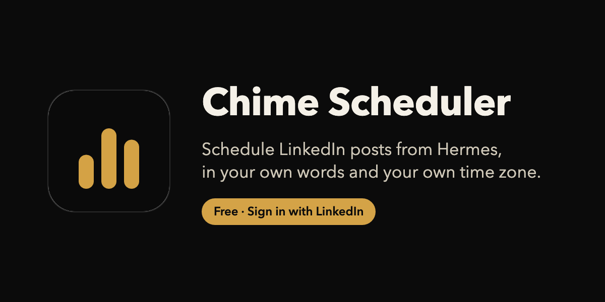

# Chime Scheduler for Hermes Agent



Schedule and publish LinkedIn posts on your own profile from Hermes. Write a post with the agent,
say when it should go out in your own words ("Tuesday at 9am", "tomorrow morning"), and Chime
Scheduler publishes it at that time. The exact time in your time zone is echoed back so you can
catch a mistake before anything goes live.

Free. No API key. You sign in with LinkedIn in your browser.

This package connects Hermes to Chime Scheduler's hosted MCP server at
`https://schedule.getchime.co/mcp` (Streamable HTTP, OAuth) and adds one skill,
`chime-scheduler:chime-scheduler`, that tells the agent how to schedule safely.

## Install

```bash
hermes plugins install chime-scheduler
hermes plugins enable chime-scheduler
```

## Sign in (once)

Agent Plugins v1 packages cannot ask Hermes for OAuth, so the sign-in uses a normal Hermes server
entry with the same name. Add this to your profile's `config.yaml` (replace any existing
`chime-scheduler` entry as a whole):

```yaml
mcp_servers:
  chime-scheduler:
    url: "https://schedule.getchime.co/mcp"
    auth: oauth
    trust: untrusted
```

Then run:

```bash
hermes mcp login chime-scheduler
```

Your browser opens Chime Scheduler's sign-in page, which shows that Hermes Agent is asking for
access. Click **Sign in with LinkedIn** and approve. Hermes stores and refreshes the sign-in itself;
this package never sees it. Check it with `hermes mcp test chime-scheduler`, then start a new
session.

A `config.yaml` entry with the same name replaces the package's own server entry, including its
`trust: untrusted` setting, so keep `trust: untrusted` in the entry above. With it, Hermes asks you
before every tool that can change something (see the table below) and refuses those tools in
unattended runs such as cron. If you already added the server under another name (for example
`chime`), you do not need this package's server; remove one of the two so the tools are not
listed twice.

On a machine with no browser, run `hermes mcp login chime-scheduler` in a terminal, open the printed
link on any device, and follow Hermes's prompts. An unattended run never waits for a browser.

## Try saying

- "Interview me for 2 minutes about my work, then write my first LinkedIn post and schedule it for tomorrow at 9am."
- "Plan my LinkedIn week: suggest 3 post ideas, draft them, and schedule them Mon, Wed and Fri at 9am."
- "Give me 5 LinkedIn post ideas for someone in my role, write the best one, and schedule it for Tuesday at 9am."
- "Delete the LinkedIn post I published most recently." (the agent asks you first)

## Tools

The server provides these tools at run time.

| Tool | Read or write | Hermes asks first? | What it does |
|---|---|---|---|
| `get_status` | Read | No | Whether LinkedIn is connected and when the login expires, your time zone and local time, scheduled posts and drafts, posts that need attention, and recent live links. |
| `list_posts` | Read | No | Lists posts with status, local time and the start of the text. |
| `list_uploads` | Read | No | Lists recent uploads with file names, kind and size. |
| `schedule_post` | Write | Yes | Schedules a post for a time on your clock, or saves a draft, with an optional first comment and images or video. |
| `post_now` | Write | Yes | Publishes a post on LinkedIn right away and returns the live link. |
| `edit_post` | Write | Yes | Changes the text, first comment, time or media of a post that has not gone out yet. |
| `cancel_post` | Write | Yes | Cancels a scheduled or held post or deletes a draft. Deletes a post already live on LinkedIn only after you confirm. |
| `get_upload_link` | Write | Yes | Creates a private, single-use upload link for up to 9 images or one MP4 video. |

Limits: personal LinkedIn profiles only (no company pages), posts up to 3,000 characters, no PDF
carousels, and the LinkedIn login lasts 60 days before you reconnect.

## Disclosure

- **Hosted-only connector.** This package is configuration and Markdown only: `plugin.json`,
  `mcp.json`, one skill and this README. It contains no code that runs on your machine, starts no
  local process, reads no files outside its own folder, and sends no telemetry of its own.
- **Network.** Every tool call goes to Chime Scheduler at `https://schedule.getchime.co`, run by
  Wednesday Solutions, Inc. The post text, times, first comments and files you upload are sent
  there so they can be published.
- **Sign-in.** You sign in with LinkedIn in your browser through Chime Scheduler's OAuth server
  (`https://schedule.getchime.co`). Hermes stores the resulting token under its own MCP token store.
  Chime Scheduler keeps your LinkedIn access token encrypted on its side; the agent never sees it.
- **What it posts.** Posts go only to your own LinkedIn profile, and only when you ask: scheduled for
  the time you chose, or straight away with `post_now`. Chime Scheduler never reads your LinkedIn
  feed, messages or connections. A post that can't go out on time is held, never posted late
  without you choosing to.
- **Emails.** Chime Scheduler emails you only about your own posts (a post that didn't go out, a
  held video, a LinkedIn login about to expire or expired).
- **Analytics.** Chime Scheduler uses product analytics and never records the text of your posts
  or your chat. See the privacy policy for details.
- **Your data.** To have your data deleted, email [support@getchime.co](mailto:support@getchime.co)
  from the email address on your LinkedIn account. Removing the server from Hermes does not cancel
  scheduled posts; ask the agent to cancel them first.
- **Not pinned.** The tool set is served by the remote server at run time and is not covered by
  the commit this package is pinned to in the Hermes catalog.

- Privacy: https://schedule.getchime.co/privacy
- Terms: https://schedule.getchime.co/terms
- Help: https://schedule.getchime.co/help

## Troubleshooting

| Symptom | Fix |
|---|---|
| No Chime Scheduler tools in a session | Run `hermes plugins list` and `hermes mcp list`, check the sign-in step above, then start a new session. |
| `hermes mcp test chime-scheduler` says the server is not configured | Add the `config.yaml` entry from "Sign in (once)". |
| Sign-in stopped working | Run `hermes mcp login chime-scheduler` again. |
| The agent says the LinkedIn login expired | Open the reconnect link it gives you (from `get_status`). |

## Support

- Website: https://schedule.getchime.co/?utm_source=hermes&utm_medium=directory&utm_campaign=scheduler_listings
- Email: [support@getchime.co](mailto:support@getchime.co)
- Issues: https://github.com/wednesday-solutions/chime-scheduler/issues

Chime Scheduler is not affiliated with LinkedIn.
